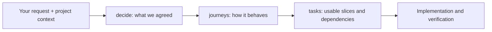

# Agentic Skills

Three skills that help a coding agent agree on what to build, describe how it should
behave, and carry that agreement into implementation.

**decide** records your choices and unanswered questions. **journeys** turns those
choices into steps, branches and testable behavior. **tasks** maps agreed behavior
to usable implementation slices, dependencies and safe parallel work. The optional
journeys validator checks references and recorded coverage, not task execution.

These are Markdown instructions an agent follows when invoked. They do not run in
the background. The skills work without a particular language or framework; the
optional validator requires Bun 1.4+ and has no third-party dependencies.

Experimental v0.1. Start with one feature.



## decide: What are we actually building?

**Input:** your request, existing decisions, and relevant project code or docs.
**Output:** a decision record, normally `docs/decisions.md`.

Suppose you say:

> Use decide to plan team invitations. Only admins can invite people. Links expire
> after 48 hours and can be revoked. We want shareable links without email delivery.
> Read our membership model before asking questions.

The agent preserves those answers and separates four things:

| Kind | Example |
|---|---|
| Accepted decision | Only admins can create invitations |
| Explicit exclusion | Email delivery is outside this feature |
| Observation | The current endpoint lets every member invite |
| Open question | Which role should the recipient receive? |

It records the choices with stable IDs, their sources, rationale and relevant
alternatives. If the role is unspecified, it asks about that with a recommendation
instead of choosing a product rule silently. It asks only when an answer changes an in-scope outcome and blocks the next useful
slice, then continues independent work. “Next gap” does not expand the agreed scope.
When no material owner blocker remains, discovery stops. Deferral and exclusion are
valid outcomes; retry/locking mechanics normally remain the builder's work.

A later agent can read the same record without asking you to repeat settled answers.
If an accepted choice changes, its replacement names the decision it supersedes,
so affected references can be reviewed.

You own the product choices. Existing code, an agent's recommendation and an
unanswered suggestion do not become accepted policy automatically.

## journeys: What happens in each case?

**Input:** the decision record or another agreed specification, plus relevant code
when reviewing an existing feature. **Output:** `docs/journeys/<feature>.yaml`
and a generated Markdown view with diagrams and acceptance criteria.

For the invitation feature, ask:

> Use journeys to map creating, revoking and accepting invitations. Include expired
> links, repeat acceptance, permission changes and losing the acceptance response.
> Keep unanswered product questions visible.

The agent first lists actor goals and recovery entry points: an admin creates or
revokes an invitation; a recipient accepts it or resumes after a lost response.
This is the **coverage inventory**. Each goal is mapped to journeys, explicitly
excluded by an accepted scope decision, or marked unresolved.

It writes this inventory before detailing the graph, so reviewing coverage is more
than checking the journeys it already happened to draw.

Lightweight mapping is the default: the ordinary path and applicable failures,
with deeper analysis for money, access and data-integrity consequences. A journey
can declare its applicable review categories instead of filling a mandatory matrix.

Then it expands each journey into steps and branches. At relevant steps it asks:

- What if input or permission is invalid?
- What if a dependency times out or returns a partial result?
- What if two requests race, an event arrives twice, or the process crashes?
- What survives, what can retry, and what outcome does the person see?

It identifies **invariants**, rules that must hold across paths, such as never
granting membership in the wrong workspace. Each step cites the decisions it relies
on and the invariants it could break. Missing policy stays an open question.

## How journeys uses EARS

EARS means **Easy Approach to Requirements Syntax**. Alistair Mavin and colleagues
at Rolls-Royce published it in 2009 to structure natural-language requirements.
See the [original paper](https://doi.org/10.1109/RE.2009.9).

Journeys uses EARS-style sentences for acceptance criteria. Each sentence names
one observable behavior and the condition under which it is required.

Compare “handle invalid invitations properly” with:

```text
IF an invitation has been revoked
THE SYSTEM SHALL NOT grant membership.
```

The second gives the builder and reviewer a specific condition and forbidden effect.
The skill commonly uses these forms:

| Form | Purpose | Invitation example |
|---|---|---|
| `WHEN … THE SYSTEM SHALL …` | Response to an event | WHEN an existing member accepts an invitation THE SYSTEM SHALL return already-member without creating another membership |
| `WHILE … THE SYSTEM SHALL …` | Behavior during a state | WHILE acceptance is pending THE SYSTEM SHALL show that the request is pending |
| `IF … THE SYSTEM SHALL NOT …` | A forbidden effect under an unwanted condition | IF the invitation is expired THE SYSTEM SHALL NOT grant membership |
| `THE SYSTEM SHALL NOT …` | A rule that always holds | THE SYSTEM SHALL NOT grant membership in a different workspace |

These are illustrative requirements; a real project must establish their policy.
The skill uses an adaptation of EARS, including direct negative `IF` criteria.
The original unwanted-behavior template uses `IF … THEN … SHALL …`; this toolkit
is not a full EARS grammar checker.

EARS helps make a requirement precise enough to discuss and test. It does not
choose the right product rule or prove that implementation satisfies it.

## Observations: What does the existing project actually do?

When reviewing code, the agent might find that a retry handler resets an import
before submitting it to a queue. It records that as an observation with the source
file, revision and location, then checks the handoff: what resumes the import if the
process stops between those actions?

If a recovery path is missing or unclear, that remains visible in the inventory.
The agent does not invent recovery policy or treat current behavior as approval.
An observation-only map can describe the system without being ready to implement
as an agreed specification.

## Validator: Do the recorded pieces hold together?

The agent reasons about goals and behavior. The validator performs mechanical
checks on documents written in the supported format.

It catches missing decision, step or journey references; unreachable steps; paths
without exits; reused retired IDs; missing forbidden-effect criteria on steps that
reference invariants; and stale generated Markdown. Coverage and readiness gates
also reject their respective unresolved entries.

For example, if the inventory maps “Retry an import” to J1 and someone deletes J1,
the checker reports:

```text
C1: missing mapped journey J1
```

If both the inventory goal and J1 disappear, the checker cannot infer their absence.
A person or agent still needs to compare the inventory with user goals and source
entry points, and judge whether a mapping really covers its goal.

## tasks: What can we build next, and in parallel?

**Input:** agreed journeys or another specification, plus the actual code.
**Output:** one compact backlog, normally `docs/tasks/<feature>.md`.

> Use tasks to plan the next usable slice from our agreed journeys. Inspect the
> implementation first; identify dependencies, parallel work and verification.

For a new application, plan the minimum foundations for an end-to-end slice. For an
existing feature, inspect what works and plan the gap. A prototype is not durable
implementation. Tasks link source criterion IDs rather than copy their text, and
name outcomes, relevant files, required/provided contracts and completion evidence.

Parallel work needs available inputs and compatible write scopes, including shared
schema and resources. Group usable outcomes instead of making one task per journey.
Include integration and delivery work needed for the agreed target. Detail the next
slice; keep later work coarse but accounted for. Stop when the plan is actionable.

The [task record](skills/tasks/references/task-record.md) has the compact format and
manual coverage/dependency checks. No task-management runtime or automatic agent
dispatch is installed. The task skill has no automated graph or coverage checker.

## Keep documentation small

One authoritative home per fact: decisions own policy, journeys own behavior, tasks
own implementation ownership and evidence. Link between them. Omit transcripts,
repeated requirements, empty sections and speculative detail. Generate secondary
views only when useful or required by a host check; never hand-maintain copies.
Read supporting references only as needed. Run checker scripts without loading their
source unless debugging them. Report changes and blockers instead of reciting documents.

Use any skill independently; none automatically chains to another. Existing agreed
specs can go straight to tasks. Skip formal planning for small, precise changes.
Tasks being checked off is not evidence of an integrated feature or release.

Existing documentation conventions take precedence. The optional checker expects
its [decision table](skills/decide/references/record-format.md) and
[journey schema](skills/journeys/references/schema.md). Other formats may need an
explicit adapter or migration; the skills can still guide manual review.

## Install

The same skill folders can be used by coding agents that support `SKILL.md` skills.
The installation directory and invocation syntax belong to your agent; the skills
themselves do not require a particular platform.

Clone this repository:

```sh
git clone https://github.com/hivinaynair/agentic-skills.git
```

Choose your agent's documented project-level skill directory to share the skills
with a team, or its personal skill directory to use them across projects. Inspect
it for existing `decide`, `journeys` or `tasks` folders before copying. Keep or deliberately
replace existing versions; do not merge copies blindly.

For a destination with none installed, copy the complete folders you need. These
shell commands assume you are in the cloned repository; replace the destination:

```sh
skill_dir=/path/to/your-agent/skills
mkdir -p "$skill_dir"
cp -R skills/decide "$skill_dir/"
cp -R skills/journeys "$skill_dir/"
cp -R skills/tasks "$skill_dir/"
```

The result should preserve the supporting files:

```text
<your-agent-skill-directory>/
  decide/SKILL.md
  decide/references/
  journeys/SKILL.md
  journeys/references/
  journeys/scripts/
  tasks/SKILL.md
  tasks/references/
```

Open or refresh your agent session according to its documentation, then check that
the installed skills appear in its available-skills list. Copying the files requires no
package installation. Bun is needed only for the optional validator.

If your agent does not support skill discovery, give it the full path to a skill's
`SKILL.md` and ask it to follow those instructions. It needs access to the supporting
files too. This is direct use, not automatic discovery. There is no plugin manifest
or universal installer in this release.

The previous seven skills and their installer have been retired. Existing installed
copies are not removed automatically; Git history retains the old repository files.

## Invoke explicitly

Ask your agent in plain language:

> Use the decide skill to settle the requirements for team invitations. Read the
> ticket and existing project context, then ask about the most important missing policy.

> Use the journeys skill to map the agreed invitation feature, including failures
> and recovery.

> Use the tasks skill to plan implementation from our journeys. Inspect existing
> code, show the next usable slice and identify work that can run in parallel.

You can also select the skill through your agent's skill picker or mention syntax.
Those controls vary by platform. If the skill is not installed, include its full
`SKILL.md` path in the request.

<details>
<summary>Codex example: installation paths and invocation</summary>

Codex discovers project skills under `.agents/skills` and personal skills under
`~/.agents/skills`. For a project installation, run the copy commands from the clone
with `skill_dir` set to `/path/to/your-project/.agents/skills`.

In Codex CLI or the IDE extension, `/skills` lists available skills and `$` mentions
one explicitly:

```text
$decide Help me settle the requirements for team invitations.
$journeys Map the agreed invitation feature, including failures and recovery.
```

If the skills do not appear, restart Codex. See the
[official documentation](https://learn.chatgpt.com/docs/build-skills). Other agents
have their own paths and controls; this example is not a required installation layout.

</details>

## Let the agent select a skill

In an agent that supports automatic skill selection, an installed skill can be
selected when your request matches its description. You do not have to name it:

> We need to plan team invitations before implementing anything. Capture settled
> requirements, exclusions and blocking product questions, then ask the most
> important unanswered question.

That is a request for the work covered by `decide`.

> Our task-archiving requirements are agreed. Map the actor goals, steps, failure
> branches, invariants and testable acceptance criteria.

That is a request for the work covered by `journeys`. Selection is an agent judgment,
not a guaranteed trigger for every wording or platform. Explicit invocation gives
you more control. Availability of automatic selection depends on the host agent.

Discovery and selection are different: a skill may be available without being used.
Look for the agent reading that installed skill's `SKILL.md` or announcing its use;
producing a similarly named document alone does not prove invocation.

The skills do not automatically chain. To request all three:

> Use decide to settle the requirements, journeys to map behavior, then tasks to
> plan implementation. Keep documentation short and preserve accepted scope.

Installing skills does not enable pre-commit hooks, background monitoring or automatic
validation of every edit. Those checks require separate commands or hook configuration.

## Tested compatibility

On 2026-10-16, fresh Codex CLI 0.147.0 sessions used copies of both skills in
isolated projects under `.agents/skills`. The prompts did not name skills or their
paths. Successful command traces confirmed the selected local `SKILL.md` was read:

| Request | Observed selection |
|---|---|
| Capture invitation requirements and blocking questions | `decide` |
| Map agreed task-archiving behavior into actor paths and acceptance criteria | `journeys` |
| Change a README heading | Neither skill |

This verifies project discovery and implicit selection for those CLI requests.
That historical discovery trial covered decide and journeys, not tasks.
Desktop UI selection, personal-directory installation, other agents and arbitrary
prompt wording remain untested. Read the [method and results](evaluation/discovery/RESULTS.md)
for the evidence, initial inconclusive attempt and reproduction command.

## Validate a feature

Set `journeys_dir` to your installed journeys folder. From your project root:

```sh
journeys_dir=/path/to/your-agent/skills/journeys
bun "$journeys_dir/scripts/journeys.ts" validate docs/journeys/invitations.yaml
bun "$journeys_dir/scripts/journeys.ts" render docs/journeys/invitations.yaml
bun "$journeys_dir/scripts/journeys.ts" check docs/journeys/invitations.yaml --coverage
bun "$journeys_dir/scripts/journeys.ts" check docs/journeys/invitations.yaml --ready
```

- `validate` checks structure and references; draft policy may produce warnings.
  Output shows at most eight warnings by default; `--verbose` shows all. Warning
  totals and gate outcomes are unchanged.
- `render` regenerates the Markdown tables and flowcharts.
- `check` also checks that generated Markdown is current.
- `--coverage` requires mapped goals or accepted exclusions and no unresolved goals.
- `--policy-ready` additionally requires accepted policy; engineering reviews may
  remain open as warnings. This is a stopping point for product discovery.
- `--ready` requires accepted policy and completed applicable branch reviews.
  Observations alone cannot authorize either policy/readiness gate.

Both gates check the entire feature file. For a slice in a larger spine, manually
review its IDs and dependencies and report that bounded result. Policy readiness,
engineering review and release evidence are separate; no flag proves working code.
Keep tasks focused on usable slices, referencing source IDs rather than maintaining
handwritten copies of criteria. Generated copies need freshness checking.

Optional verification maps link criteria to tests or other checks. Pass
`--verification docs/verification.json`; add `--require-links` to require a link
for every criterion and invariant. The checker verifies file/locator existence,
not execution or assertion quality. No command runs product tests.

## Pre-commit integration

Add this call to your existing hook manager when a feature is ready:

```sh
sh /path/to/your-agent/skills/journeys/scripts/pre-commit.sh docs/journeys/invitations.yaml --ready
```

Use `--coverage` for a source review that does not claim policy approval, or omit
both gates during drafting. The helper checks a temporary export of the staged
Git files without modifying or staging anything. An unstaged fix cannot disguise
a broken commit. Run the equivalent `check` in CI too; local hooks can be bypassed.
Do not overwrite an existing hook setup. Bun must be on PATH.

Pass the feature and any `--verification` map as paths relative to the repository
root, without `..` segments. For a validator installed inside that repository,
stage its script too: the helper runs the staged copy. A personal or external
installation uses the validator at that external location. Feature documents,
decision records, verification maps and their linked files, and generated Markdown
must resolve inside the staged export. Internal relative references and symlinks
are supported; paths resolving outside are rejected before their contents are read.

For development of this repository, `.githooks/pre-commit` optionally runs its
checks and tests against the staged snapshot. Enable it explicitly with
`git config core.hooksPath .githooks` if it fits your existing hook setup.

## Try the included example

```sh
bun run verify
```

This runs skill metadata/reference checks, offline tests and the draft invitation
example check. Run `bun run check`, `bun test` or `bun run check:example` separately
when you only need one check. It does not launch model sessions or use account quota.

The [task planning trial](evaluation/tasks/RESULTS.md) records synthetic agent
results and their limits.

The [invitation example](evaluation/team-invitations/journeys/invitations.md) is a
synthetic planning exercise, not an implemented app. Draft checking passes with
warnings; `--ready` deliberately fails. Read the [evaluation notes](evaluation/RESULTS.md).

## Limits

The validator catches broken references, unreachable steps, paths without exits,
reused retired IDs, missing forbidden-effect criteria, stale generated documents
and missing journeys referenced by the inventory.

It cannot discover a goal omitted from both the inventory and the graph, judge
whether a mapping actually covers a goal, verify the truth of source metadata,
or prove tests assert the intended behavior. Those require source and diff review.
A green check does not establish implementation correctness or complete coverage.

The tooling has been tested on macOS using Bun 1.4.0-canary.1. Stable-release Bun,
Windows hooks and cross-agent installation compatibility have not been verified.
No universal bug-prevention or measured productivity claim is made.

MIT licensed. Background inspiration includes [Superpowers](https://github.com/obra/superpowers),
[Spec Kit](https://github.com/github/spec-kit),
[GSD](https://github.com/gsd-build/get-shit-done),
[Vercel Foreman](https://github.com/vercel-labs/eve-software-factory-template), [OpenSpec](https://github.com/Fission-AI/OpenSpec)
and the [Agent Skills format](https://agentskills.io/specification).
