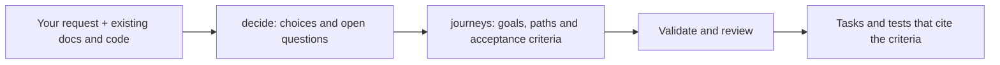

# Agentic Skills

Give your coding agent a clear agreement about what to build, how it should behave,
and what still needs an answer.

**decide** captures the choices. **journeys** follows them through the happy path,
failures, retries and recovery. An optional validator checks that the references
and recorded coverage hold together.

Experimental v0.1. Start with one feature.

| Skill | When to use it | Output |
|---|---|---|
| [decide](skills/decide/SKILL.md) | Requirements are uncertain or decisions need to survive a handoff | Accepted decisions, exclusions and open questions |
| [journeys](skills/journeys/SKILL.md) | Agreed behavior needs detailed paths, or existing behavior needs review | Coverage inventory, steps, branches, invariants and acceptance criteria |

The skills are ordinary Markdown instructions. They require no particular language,
framework, account or service. The optional validator uses Bun 1.4+ with no third-party
dependencies. These skills plan and review; they do not generate application code by default.

## Install

Copy the entire `skills/decide` and `skills/journeys` folders into your agent's skill
directory, preserving their references and scripts. Inspect the destination first;
do not overwrite existing skills with the same names. For a project that discovers
skills under `.agents/skills`, the result is:

```text
.agents/skills/
  decide/SKILL.md
  decide/references/
  journeys/SKILL.md
  journeys/references/
  journeys/scripts/
```

You can also point an agent directly at the two SKILL.md files without installing.
Discovery locations and invocation syntax depend on the agent. Explicit-path use
has been exercised in Codex; other agent installers have not been verified. There
is no agent-specific plugin manifest.

The previous seven skills and their installer have been retired from this repository.
Existing installed copies are not removed automatically. Git history retains the old files.

## How it works



| Stage | Input | What you get |
|---|---|---|
| Decide | Your intent, constraints and existing requirements | Decisions, exclusions and questions in `docs/decisions.md` |
| Inventory | Actor goals, entry points and recovery needs | A list of goals marked mapped, excluded or unresolved |
| Journeys | Agreed decisions and source-backed observations | `docs/journeys/<feature>.yaml` with steps, branches, exits and acceptance criteria |
| Render and check | The decision record and journey file | A readable Markdown view with diagrams, plus errors or warnings |
| Implementation handoff | Reviewed criteria with stable IDs | A basis for tasks and tests; implementation is separate work |

You remain the owner of product choices. The agent preserves settled answers and
asks about missing policy instead of silently choosing it. Use either skill on its
own: an existing agreed specification can be the input to journeys.

Existing project conventions take precedence. The optional checker expects the
[decision table](skills/decide/references/record-format.md) and
[journey schema](skills/journeys/references/schema.md). Other formats may need an
explicit adapter or migration; the skills can still guide manual review.

## Example 1: Plan team invitations

Start with what you already know:

> Use decide to plan team invitations. Only workspace admins can invite people.
> Invitations expire after 48 hours and can be revoked. We want shareable links,
> not email delivery. Read our existing membership model before asking questions.

The agent records those choices and exclusions. If the recipient's membership role
is unspecified, it asks about that rather than inventing an admin/member default.
A shortened, illustrative result might look like this:

| ID | Status | Meaning |
|---|---|---|
| D1 | Accepted | Only workspace admins can create invitations |
| D2 | Accepted | Invitations expire after 48 hours |
| X1 | Accepted exclusion | No email delivery in this feature |
| Q1 | Open | Which role does a new member receive? |

This is an explanatory summary, not the full machine-readable decision table.

Then ask:

> Use journeys to map the invitation feature from those decisions. Include
> creating, revoking and accepting invitations, expired links, repeat acceptance,
> and losing the response after acceptance. Keep the unanswered role question open.

The output gives each behavior an ID. For example:

```text
J3.S4.c1: WHEN an existing member accepts the invitation
          THE SYSTEM SHALL return already-member without another membership

J3.S4.c2: IF the invitation has been revoked
          THE SYSTEM SHALL NOT grant membership
```

These are illustrative criteria, not excerpts with matching IDs from the included
fixture. Tasks and tests can cite the actual generated IDs. A task that grants a new
membership remains blocked on Q1; unrelated paths can still be specified.

Explore the complete synthetic trial: [brief](evaluation/brief.md),
[decisions](evaluation/team-invitations/decisions.md), and
[rendered journeys](evaluation/team-invitations/journeys/invitations.md).

## Example 2: Review an existing retry flow

> Use journeys to review our file-import retry flow. Inspect the retry endpoint,
> queue submission, worker completion, cancellation and scheduled recovery.
> Record current behavior with source references. Do not treat existing code as
> approved policy or change the implementation.

Suppose the handler resets a failed import before submitting it to the queue.
The agent records that as an observation. This illustrative YAML fragment shows
its source reference; use the real path, revision and locator from your project:

```yaml
observations:
  - id: O1
    statement: The handler resets the import before submitting work to the queue
    sources:
      - ref: src/imports/retry.ts
        revision: abc1234
        locator: retryImport
```

That observation raises a review question: what resumes the import if the process
stops between the reset and queue submission? The agent looks for an existing
recovery path. If none is established, it records the gap rather than claiming
the system already handles it or inventing a retry policy.

```yaml
coverage:
  - id: C1
    actor: user
    goal: Retry a failed import
    status: mapped
    journeys: [J1]
  - id: C2
    actor: worker
    goal: Recover an import interrupted before queue submission
    status: unresolved
    reason: No recovery path or approved exclusion has been established
```

These are fragments, not a standalone valid spine. The complete file also defines
actors, journeys and the other required fields. `--coverage` fails while C2 is
unresolved. Even a complete observation-only map cannot pass `--ready`: descriptions
of current behavior do not approve future requirements.

## Example 3: Catch a journey removed during an edit

Suppose the inventory maps “Retry a failed import” to J1. Someone removes J1 but
leaves C1 pointing to it. The validator reports:

```text
C1: missing mapped journey J1
```

The pre-commit helper can catch that in the staged files before the commit succeeds.
It also checks step targets and decision references, so a renamed or retired ID
cannot silently leave a broken link behind.

If someone removes **both** C1 and J1, the checker cannot infer the missing goal.
That is why the inventory is written from user goals and source entry points first,
and reviewed against those sources after changes.

## When to use these skills

Use them before a feature with unclear requirements, when handing work to another
agent, when reviewing existing behavior, or when a policy change affects several
paths. They are especially useful when retries, permissions and partial failures
matter as much as the happy path.

Skip the full workflow for a small styling fix or an already precise implementation
task. These skills do not replace source review, design judgment or behavior tests.

## Validate a feature

With the journeys folder installed at `.agents/skills/journeys`:

```sh
bun .agents/skills/journeys/scripts/journeys.ts validate docs/journeys/invitations.yaml
bun .agents/skills/journeys/scripts/journeys.ts render docs/journeys/invitations.yaml
bun .agents/skills/journeys/scripts/journeys.ts check docs/journeys/invitations.yaml --coverage
bun .agents/skills/journeys/scripts/journeys.ts check docs/journeys/invitations.yaml --ready
```

- `validate` checks structure and references; draft policy may produce warnings.
- `render` regenerates the Markdown tables and flowcharts.
- `check` also checks that generated Markdown is current.
- `--coverage` requires mapped goals or accepted exclusions and no unresolved goals.
- `--ready` additionally requires accepted policy and completed branch reviews.
  Observations alone cannot authorize readiness.

Optional verification maps link criteria to tests or other checks. Pass
`--verification docs/verification.json`; add `--require-links` to require a link
for every criterion and invariant. The checker verifies file/locator existence,
not execution or assertion quality. No command runs product tests.

## Pre-commit integration

Add this call to your existing hook manager when a feature is ready:

```sh
sh .agents/skills/journeys/scripts/pre-commit.sh docs/journeys/invitations.yaml --ready
```

Use `--coverage` for a source review that does not claim policy approval, or omit
both gates during drafting. The helper checks a temporary export of the staged
Git files without modifying or staging anything. An unstaged fix cannot disguise
a broken commit. Run the equivalent `check` in CI too; local hooks can be bypassed.
Do not overwrite an existing hook setup. Bun must be on PATH.

For development of this repository, `.githooks/pre-commit` optionally runs its
checks and tests against the staged snapshot. Enable it explicitly with
`git config core.hooksPath .githooks` if it fits your existing hook setup.

## Try the included example

```sh
bun run check
bun test
bun skills/journeys/scripts/journeys.ts check evaluation/team-invitations/journeys/invitations.yaml
```

The [invitation example](evaluation/team-invitations/journeys/invitations.md) is a
synthetic planning exercise, not an implemented app. Draft checking passes with
warnings; `--ready` deliberately fails. Read the [evaluation notes](evaluation/RESULTS.md).

## Limits

The validator catches broken references, unreachable steps, paths without exits,
reused retired IDs, missing forbidden-effect criteria, stale generated documents
and missing journeys referenced by the inventory.

It cannot discover a goal omitted from both the inventory and the graph, judge
whether a mapping actually covers a goal, verify the truth of source metadata,
or prove tests assert the intended behavior. Those require source and diff review.
A green check does not establish implementation correctness or complete coverage.

The tooling has been tested on macOS using Bun 1.4.0-canary.1. Stable-release Bun,
Windows hooks and cross-agent installation compatibility have not been verified.
No universal bug-prevention or measured productivity claim is made.

MIT licensed. Background inspiration includes [Superpowers](https://github.com/obra/superpowers),
[Spec Kit](https://github.com/github/spec-kit), [OpenSpec](https://github.com/Fission-AI/OpenSpec)
and the [Agent Skills format](https://agentskills.io/specification).
