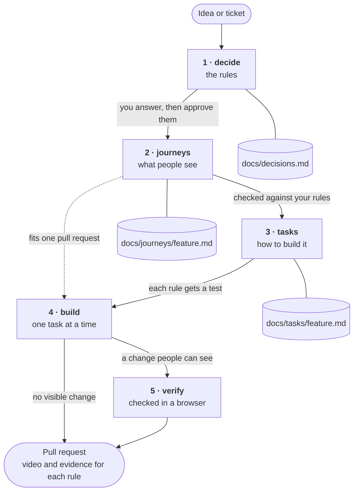

# Agentic Skills

Five skills for AI coding agents. Before any code is written, they turn your idea
or ticket into a short spec you approve; then they build it task by task, with a
test proving every rule, and show you it working in a browser before the pull request.

## The problem

When you ask an agent to build something, it fills every gap in your request with
a guess: who is allowed to do it, what happens when payment fails, what the person
sees on a bad link. Those guesses end up in the code, and you find them later.
These skills make the agent ask instead, write down what you decided, and tell you
plainly when the spec is complete enough to build.

## How it works



- **decide** asks you questions, each with a recommendation, writes every answer
  as a one-line rule, and asks you to approve the rules for build.
- **journeys** writes each path a person takes, screen by screen, including what
  they see when something goes wrong. A separate review checks it follows your
  rules exactly; if it needs a rule you have not decided, you get one more question.
- **tasks** splits the build into pieces a person can use and names the test that
  proves each rule.
- **build** implements one task at a time (a small spec that fits one pull request
  can skip tasks; build writes its one-task plan itself): the planned tests first, then the code,
  then the evidence, then a pull request naming the rules it implements. A bug that
  breaks an approved rule is fixed the same way.
- **verify** opens the app in a real browser and checks every rule on screen before
  the pull request; see below.

## Seeing it work before review

Tests prove the code; verify proves what a person sees. For any change people can
see, build hands over to verify, which drives a real browser with
[agent-browser](https://github.com/vercel-labs/agent-browser):

1. **Check.** It opens the app (a preview deploy or local, never production) and
   checks every criterion the change touches, including the not allowed, bad input,
   failure and repeat cases, with a screenshot of each.
2. **Fix and re-check.** A failure means a code fix and then every criterion checked
   again, at most three rounds. It may change only product code, never the rules or
   tests; a rule that looks wrong goes back to you as a question.
3. **Explore** (money, permissions, data). agent-browser's `dogfood` skill clicks
   around the changed area like a user. Bugs this change caused get fixed; behavior
   no rule decides becomes a question; older bugs are listed, not fixed.
4. **Record.** Only once everything passes, it records one clean video of the main
   path and a failure case, under a minute, with a screenshot per criterion.
5. **Hand over.** The pull request's Walkthrough section gets the video and one line
   per criterion with its result and screenshot.

So the reviewer watches the change working before reading its code. In CI,
[agentic-team-kit](https://github.com/hivinaynair/agentic-team-kit) adds Playwright
journey tests that record every journey on every push and comment the results on
the pull request.

## What you do

Two things: **answer questions, then approve the rules.** You never need
to run a command. The agent runs a small checker, a spell-check for specs: it
catches missing cases and contradictions, and notices when a later change means
your approval no longer applies.

## Three ways to use it

It is always the same loop; only the start differs.

- **A new product.** Ask *"Use decide to shape this idea."* It first pins down the
  problem, who it is for, the first thing they should be able to do and what is out
  of scope. Then map and build **one feature at a time**, not the whole product up front.
- **A new feature.** Ask *"Use decide to plan CSV export"*, or paste the ticket. It
  reads the existing code and decisions first. When someone else owns the answers
  (a PM, a client), you get one list of questions grouped by who answers them, each
  with a recommendation, ready to paste into Slack or email.
- **Changing a feature.** Say what you want to change. Before anything is edited, the
  agent tells you which screens, rules and tests the change affects and whether
  something you already approved will need your yes again.

Small, precise changes ("rename this button") need none of this. Use it when a change
affects who can do what, what people see, money or data.

## What it looks like

You ask: *"Use decide to plan password reset."* The agent asks:

> How long should a reset link work? I suggest 30 minutes.

Your answer becomes one line in `docs/decisions.md`:

```markdown
- D6 accepted — A reset link works once and expires 30 minutes after it is sent.
```

Once the journeys are mapped and reviewed, you can read them as a plain summary,
to share or just to see what will be built:

```markdown
## Set a new password

1. **Open the reset link** — Reset password; sees password form, or "This link no longer works"
   - When a usable link is opened: the new password form shows.
   - If the link is expired, used or replaced: the form does not show.

When it goes wrong:
- Not allowed: If the link is expired, used or replaced: the form does not show.
- Failure: the person sees a retryable error and no partial change is kept.
```

Every journey answers four questions: what happens when someone is **not allowed**,
enters **bad input**, hits a **failure**, or **repeats** the action. Most bugs hide
there. The full run is in [examples/password-reset](examples/password-reset/).

## Install

Copy the skill folders into the folder your agent loads skills from. For Claude
Code that is `.claude/skills/` in your project, or `~/.claude/skills/` for every project:

```sh
git clone https://github.com/hivinaynair/agentic-skills.git
mkdir -p .claude/skills
cp -R agentic-skills/skills/{decide,journeys,tasks,build,verify} .claude/skills/
```

Then ask in plain words: *"Use decide to shape this idea"*, *"Map the journeys for
password reset"*, *"Plan the tasks for the approved journeys"*, *"Build the next task"*,
*"Verify this in the browser"*. If your agent has no skill folder, point it at a
skill's `SKILL.md` file directly. The checker needs [Bun](https://bun.sh) 1.4+ and
nothing else; verify needs agent-browser 0.41.0 (`npm i -g agent-browser@0.41.0`)
and `ffmpeg`.

## Examples

- [Password reset](examples/password-reset/): the full flow, from idea to approved
  journeys and a task plan.
- [Team invitations](examples/team-invitations/): a spec that is not ready, with
  four open questions, to show what blocked looks like.

## For a team

[agentic-team-kit](https://github.com/hivinaynair/agentic-team-kit) is a starter
for a company repository whose team uses agents across Claude Code, Cursor and
Copilot: one `AGENTS.md` every tool reads, a guide that routes each change by risk
(only money, permissions, data and cross-feature work get a spec), a PR template
with a Walkthrough section, CI that checks specs and records Playwright journey
tests, and a script that installs these skills for every tool.

## Evidence so far

Small trials with a blind judge, one run per case, so treat them as a direction, not
a measurement. Agents using the skills invented no product rules, gave the clearest
"ready or not" answer, matched the owner's policy better and traced every rule to a
test, in about half to two thirds of the words. Agents without them read the code
more deeply and found more failure cases; on a full idea-to-plan run they scored
47 to the skills' 44.

## For agents and tool builders

Everything below is what the agent works with. You do not need it to use the skills.

### Who decides what

The **owner** decides what the product does: who may do what, and what people see.
The **builder** (the agent) decides how: databases, retries, code structure. Owner
decisions live in the decision record; builder choices live in the task plan.

### Files and IDs

| File | Holds | IDs |
|---|---|---|
| `docs/decisions.md` | decisions, non-goals, open questions | `D6`, `X1`, `Q2` |
| `docs/journeys/<feature>.md` | goals, journeys, steps, criteria, invariants | `J2.S1`, `J2.S1.c1`, `I1` |
| `docs/tasks/<feature>.md` | slices, builder notes, a named test per criterion | `T1` |

Formats: [decision record](skills/decide/references/record-format.md),
[journeys](skills/journeys/references/format.md),
[task record](skills/tasks/references/task-record.md). Criteria use
[EARS](https://doi.org/10.1109/RE.2009.9)-style sentences: `When <condition>: <behavior>.`

### The checker

Two commands. `check` reads whatever it is given: a journeys file, a task plan or a
project index. `approve` stamps a spec once its independent review passes.

```sh
bun skills/journeys/scripts/journeys.ts check docs/journeys/password-reset.md            # while drafting
bun skills/journeys/scripts/journeys.ts check docs/journeys/password-reset.md --ready    # before building
bun skills/journeys/scripts/journeys.ts check docs/journeys/password-reset.md --summary  # a plain page to share
bun skills/journeys/scripts/journeys.ts check docs/journeys/password-reset.md --impact D6 # before changing D6
bun skills/journeys/scripts/journeys.ts approve docs/journeys/password-reset.md D11      # record approval
bun skills/journeys/scripts/journeys.ts check docs/tasks/password-reset.md --status      # build progress
bun skills/journeys/scripts/journeys.ts check docs/decisions.md --questions               # questions to send
```

It is plain code with no AI, so it checks structure: steps nothing leads to, paths
that never end, rules citing missing or replaced decisions, decisions no step
covers, open questions, unanswered outcome checks, stale approvals, criteria without
a task or test. `--review` prints each step beside the decisions it rests on, for a
person or agent to judge the meaning. A passing check shows the spec is consistent
and approved; it cannot tell whether the idea is right or the code works.
`skills/journeys/scripts/pre-commit.sh` runs it from a Git hook.

### When your project grows

With several specs, an index (`docs/journeys/index.md`) lists every feature, written
or planned, with its task plans. `check` on the index checks them all together, plus
links between specs and decisions no spec maps, and prints one status row per spec.
The index can also add outcome checks to the four defaults where a risk recurs, such
as `money`, `privacy` or `offline`. See
[when your project grows](skills/journeys/references/format.md#when-your-project-grows)
and the [examples index](examples/index.md).

## Background

Inspired by [Superpowers](https://github.com/obra/superpowers),
[Spec Kit](https://github.com/github/spec-kit) and [OpenSpec](https://github.com/Fission-AI/OpenSpec).
MIT licensed. Run `bun run verify` to check the skills, tests and examples.
