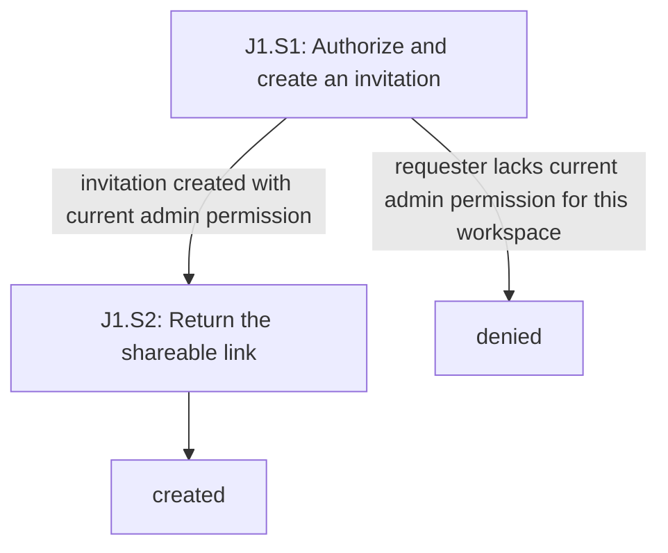
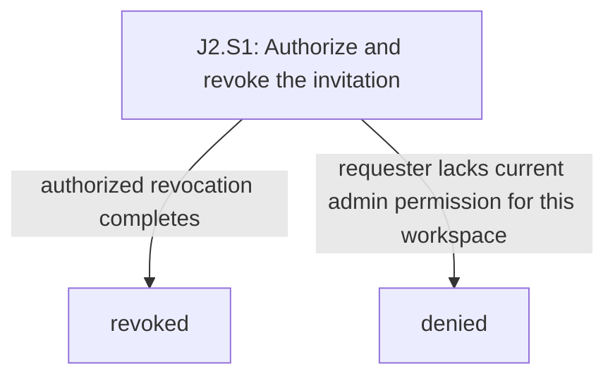
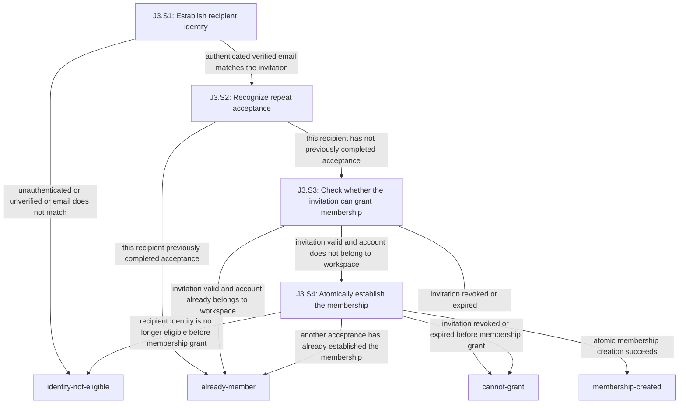

# team-invitations

<!-- Generated by journeys.ts; edit the YAML source. -->

Decisions: [source](../decisions.md)

## Invariants

- **I1**: THE SYSTEM SHALL NOT create or revoke a workspace invitation for a requester who is not currently an admin of that workspace (D1, D2, D9)
- **I2**: THE SYSTEM SHALL NOT grant invitation membership without a matching authenticated verified email (D3)
- **I3**: THE SYSTEM SHALL NOT grant membership using an invitation that is revoked or at least 48 hours old (D4, D5)
- **I4**: THE SYSTEM SHALL NOT create more than one membership per workspace and account through acceptance (D6, D8)

## J1: Create a shareable invitation

Actor: requester. Entry: J1.S1. Exits: created, denied.

| Step | Kind | Decisions | Invariants |
|---|---|---|---|
| J1.S1: Authorize and create an invitation | system | D1, D4, D9 | I1 |
| J1.S2: Return the shareable link | system | D7, X1 |  |

### J1.S1

- **J1.S1.c1**: WHEN a current workspace admin creates an invitation THE SYSTEM SHALL set its expiration to 48 hours after creation
- **J1.S1.c2**: IF the requester is not an admin of the invited workspace at creation time THE SYSTEM SHALL NOT create the invitation

### J1.S2

- **J1.S2.c1**: WHEN the invitation is created THE SYSTEM SHALL return a shareable acceptance link

### Branch review

- **input**: open; Q2 leaves malformed invitation addresses and deleted-workspace outcomes unresolved.
- **permissions**: covered; Current workspace admin permission is required at creation time. (J1.S1.c2)
- **interruption**: open; Q4 leaves interruption and unknown completion of creation unresolved.
- **dependencies**: open; Email delivery is excluded by X1 but local persistence can fail; Q4 leaves the requester outcome unresolved.
- **duplicates**: open; Q3 leaves repeat creation and multiple active links unresolved.
- **concurrency**: open; J1.S1.c2 covers current admin permission but Q3 leaves concurrent creation outcomes unresolved.
- **recovery**: open; Q3 and Q4 leave lost-link response recovery and creation retry behavior unresolved.

## J2: Revoke an invitation

Actor: requester. Entry: J2.S1. Exits: revoked, denied.

| Step | Kind | Decisions | Invariants |
|---|---|---|---|
| J2.S1: Authorize and revoke the invitation | system | D2, D5, D9 | I1 |

### J2.S1

- **J2.S1.c1**: WHEN a current admin revokes an invitation for that workspace THE SYSTEM SHALL mark that invitation revoked
- **J2.S1.c2**: IF the requester is not an admin of the invitation's workspace at revocation time THE SYSTEM SHALL NOT revoke it

### Branch review

- **input**: open; Q2 leaves revocation of a missing invitation or invitation in a deleted workspace unresolved.
- **permissions**: covered; Revocation checks current admin permission for the invitation workspace. (J2.S1.c2)
- **interruption**: open; Q4 leaves interrupted revocation and its unknown-completion outcome unresolved.
- **dependencies**: open; Local persistence failure can prevent revocation; Q4 leaves the requester outcome unresolved.
- **duplicates**: open; J2.S1.c1 preserves revoked state but Q4 leaves the visible repeat-revocation outcome unresolved.
- **concurrency**: covered; Revocation and a competing membership grant must respect revoked state at grant time. (J2.S1.c1)
- **recovery**: open; Q4 leaves retry or state retrieval after an unconfirmed revocation unresolved.

## J3: Accept an invitation

Actor: recipient. Entry: J3.S1. Exits: identity-not-eligible, already-member, cannot-grant, membership-created.

| Step | Kind | Decisions | Invariants |
|---|---|---|---|
| J3.S1: Establish recipient identity | system | D3 | I2 |
| J3.S2: Recognize repeat acceptance | system | D6, D8 | I4 |
| J3.S3: Check whether the invitation can grant membership | system | D4, D5, D6, D9 | I3, I4 |
| J3.S4: Atomically establish the membership | system | D3, D4, D5, D6, D8, Q1 | I2, I3, I4 |

### J3.S1

- **J3.S1.c1**: IF the accepting account lacks an authenticated verified email matching the invitation THE SYSTEM SHALL NOT grant membership

### J3.S2

- **J3.S2.c1**: WHEN the same recipient repeats a completed acceptance THE SYSTEM SHALL return already-member
- **J3.S2.c2**: IF the recipient already has a membership THE SYSTEM SHALL NOT create a duplicate membership

### J3.S3

- **J3.S3.c1**: IF the invitation is revoked or the current time is at least 48 hours after its creation THE SYSTEM SHALL NOT grant membership
- **J3.S3.c2**: WHEN an existing member accepts a valid invitation THE SYSTEM SHALL return already-member
- **J3.S3.c3**: IF an accepting account already belongs to the workspace THE SYSTEM SHALL NOT create a duplicate membership
- **J3.S3.c4**: WHEN the invitation creator is later demoted THE SYSTEM SHALL retain the invitation's existing expiration and revocation state

### J3.S4

- **J3.S4.c1**: WHEN an eligible recipient accepts a valid invitation THE SYSTEM SHALL atomically create the workspace membership with the role awaiting resolution in Q1
- **J3.S4.c2**: IF acceptance requests for the same workspace and account run concurrently THE SYSTEM SHALL NOT create more than one membership
- **J3.S4.c3**: IF the invitation is revoked or expired when membership would be granted THE SYSTEM SHALL NOT grant membership
- **J3.S4.c4**: IF the accepting identity no longer has the matching authenticated verified email when membership would be granted THE SYSTEM SHALL NOT grant membership
- **J3.S4.c5**: WHEN a concurrent acceptance has already created this workspace membership THE SYSTEM SHALL return already-member

### Branch review

- **input**: open; J3.S1.c1 covers recipient identity but Q2 leaves unknown invitation and deleted-workspace outcomes unresolved.
- **permissions**: open; Q1 leaves the newly granted membership role unresolved; identity and invitation validity checks are otherwise specified.
- **interruption**: open; J3.S2.c1 covers repeated completed acceptance but Q4 leaves incomplete or unconfirmed acceptance interaction unresolved.
- **dependencies**: open; Local membership persistence can fail; Q4 leaves the recipient failure or unknown-completion outcome unresolved.
- **duplicates**: covered; Repeat acceptance and existing membership cannot duplicate a workspace membership. (J3.S2.c1, J3.S2.c2)
- **concurrency**: covered; Atomic grant prevents duplicate membership and rechecks late revocation and identity changes. (J3.S4.c2, J3.S4.c3, J3.S4.c4)
- **recovery**: open; D8 preserves membership atomicity and D6 covers completed repeats; Q4 leaves recovery interaction for failed or unconfirmed acceptance unresolved.

Retired IDs: none.
