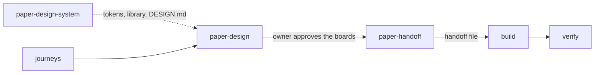

# Paper extension

Optional skills for teams that design in [Paper](https://paper.design). They
sit between journeys and build: design the approved journeys in Paper, then
hand the approved boards to build as the core
[handoff file](../../skills/verify/references/design-coverage.md). The core
skills never need them; build and verify read the handoff file the same way
whatever tool made the designs.



- **paper-design-system** builds the system once from your brand and code:
  tokens mirrored from the theme file, a Foundations page, a Components page
  with one `Component / <Name>` card per shadcn component, and an agent-ready
  `DESIGN.md`. Rerun it to sync after code or brand changes.
- **paper-design** designs or refines screens from the decisions and journeys,
  every device and state in scope, composed from a Paper library that mirrors
  your code components and tokens. It reviews usability by severity and lints
  the boards for literal values before you review them.
- **paper-handoff** names and archives the boards, runs the readiness gates
  (devices, states, components, tokens, behaviour, reach, open questions),
  writes `docs/design/handoff/<feature>.json` and a Ready for build card.

## Install

Install the core skills first, then add these beside them:

```sh
cp -R agentic-skills/extensions/paper/skills/* .claude/skills/
```

They need Paper Desktop with its MCP server connected to your agent. Then ask
*"Design the enrolment screen in Paper"* or *"The Admissions designs are final,
prepare the handoff"*.

## Start with the design system

Run *"Set up our design system in Paper"* first. The other two skills rely on
what it builds: Paper tokens named and valued like your theme, a Components
page named like your code, and `DESIGN.md`. See the
[canvas conventions](skills/paper-design/references/paper-canvas.md).

## Evaluating

Each skill has `evals/trigger-queries.json` for the description optimiser,
described in [evaluating the skills](../../docs/evaluating-skills.md).
paper-handoff (a set with planted gaps, a complete set) and paper-design (a
refinement) also have behaviour cases. They run on a synthetic Paper export,
so they test judgement, not canvas edits.
